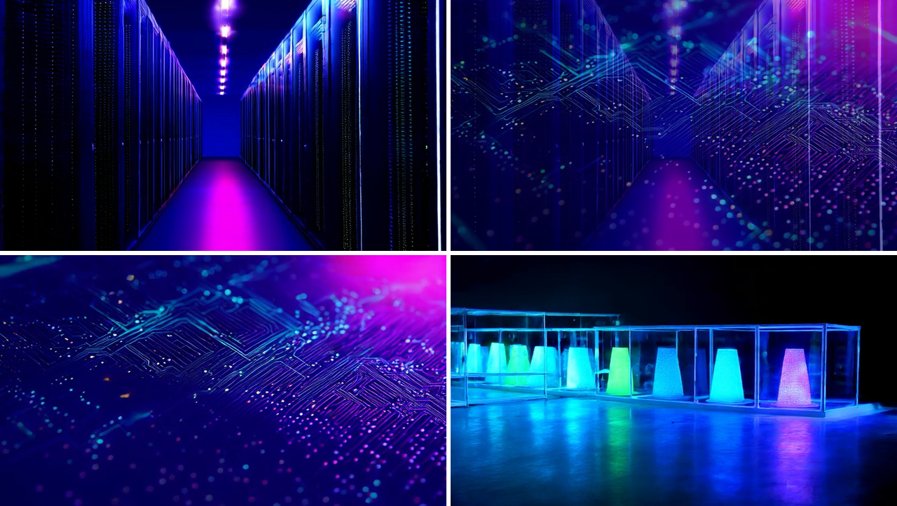

# Cavi Premiere MCP

## You call the shots.


[](LICENSE) [](https://pypi.org/project/cavi-premiere-mcp/)

Give your editing partner the footage and the direction. Cavi Premiere MCP works in a native Premiere Pro project: organize clips, shape sequences, review still frames and export a ProRes master. The project stays editable in Premiere.

Bring your own footage and licensed Adobe applications. The server connects to Premiere Pro through an Adobe Bridge relay.

## Install

Requires macOS, Premiere Pro 2026 or later, Adobe Bridge 2026 or later (the script relay), FFmpeg
(`ffprobe` and `ffmpeg`) and Python 3.15 or later with [uv](https://docs.astral.sh/uv/). `premiere_transcript`
also needs openai-whisper, or mlx-audio for a local model folder. You supply your own licensed Adobe
applications.

```sh
uv tool install cavi-premiere-mcp
```

Upgrade with `uv tool upgrade cavi-premiere-mcp`. To work from a checkout instead, see
[CONTRIBUTING.md](CONTRIBUTING.md).

Install the relay script into Bridge and approve it once in Bridge **Settings > Startup Scripts**; the
steps are in [Set up the Bridge relay](docs/premiere-mcp/source/pages/guides/bridge-setup.md).

## Quickstart

Register the stdio server with your MCP client:

```json
{"mcpServers": {"premiere": {"command": "cavi-premiere-mcp"}}}
```

If your client does not inherit your shell's `PATH`, use the absolute path that `command -v cavi-premiere-mcp` prints. Install and approve the relay using the [Bridge setup guide](docs/premiere-mcp/source/pages/guides/bridge-setup.md), then try a request like:

> Cut these three shots to the music, add dissolves, show me stills from the sequence and export a ProRes master.

The [quickstart](docs/premiere-mcp/source/pages/introduction/quickstart.md) walks through a first edit. See the [example cut](examples/first-cut/README.md) for the source media and result.

## Try one cut

This example cuts three shots and a score into a Premiere project with dissolves and a ProRes master.



[Explore the example and source media](examples/first-cut/README.md).

## What you can do

| Work | In Premiere Pro |
|---|---|
| Organize | Import media and After Effects compositions, arrange bins and find clips. |
| Edit | Create sequences, place and trim clips, work with tracks, and cut silences or transcript ranges. |
| Refine | Add transitions, adjust color, apply Lumetri looks and animate clip properties. |
| Review | Inspect the project, transcribe dialogue into captions, find cuts and silences, and export still frames. |
| Deliver | Render previews, check loudness against a delivery target, export a sequence or queue it in Media Encoder. |

See the [tool reference](docs/premiere-mcp/source/pages/reference/tools.md) for the full set of operations and parameters.

<details>
<summary>Tool inventory</summary>

| Tool | What it does |
|---|---|
| `premiere_status` | Installed Premiere Pro, Adobe Bridge and Media Encoder, relay state and mailbox. |
| `premiere_bridge_install` | Copies the relay startup script into Adobe Bridge. |
| `premiere_script` | Runs a `.jsx` file in Premiere Pro. |
| `premiere_cut` | Cuts a clip list into a new project and exports a ProRes 422 HQ master. |
| `premiere_project` | Opens, creates, saves or closes a project. |
| `premiere_inspect` | Bins, project items, sequences, tracks, clips, transitions and markers. |
| `premiere_transitions` | Lists the video and audio transitions Premiere offers. |
| `premiere_presets` | Lists export and sequence presets. |
| `premiere_effects` | Lists the video and audio effects Premiere offers. |
| `premiere_find` | Finds project items and placed clips by name or path. |
| `premiere_import` | Imports files or After Effects compositions into a bin. |
| `premiere_items` | Renames, moves, labels, subclips, interprets, proxies or deletes a project item. |
| `premiere_bins` | Creates, renames, deletes bins and moves items into them. |
| `premiere_media_replace` | Points a project item at a new file or refreshes it. |
| `premiere_sequence_new` | Creates an empty sequence. |
| `premiere_sequence_open` | Makes a sequence the active one. |
| `premiere_sequence_set` | Changes settings, in/out points, nests, duplicates, renames or deletes a sequence. |
| `premiere_tracks` | Adds tracks and sets mute, lock and target state. |
| `premiere_clip_place` | Places one project item, or many in one job, on a sequence. |
| `premiere_clip_edit` | Trims, moves, enables, renames, links or removes a placed clip. |
| `premiere_clip_copy` | Places another copy of a clip. |
| `premiere_clip_slip` | Shows a different part of a clip's source in the same place. |
| `premiere_clip_speed` | Sets a clip's speed or the duration it fills. |
| `premiere_clip_fit` | Scales a clip to fit or fill the frame. |
| `premiere_clip_props` | Sets Motion, Opacity and Volume, static or keyframed. |
| `premiere_fade` | Fades a clip in and out. |
| `premiere_color` | Basic Lumetri Color correction and Lumetri looks. |
| `premiere_effect_add` | Adds an effect to a clip. |
| `premiere_effect_set` | Sets or lists component parameters. |
| `premiere_transition_add` | Adds a transition to a clip edge. |
| `premiere_razor` | Splits clips at times. |
| `premiere_gaps` | Lists or closes empty gaps. |
| `premiere_range_remove` | Cuts one or many time ranges out of every unlocked track. |
| `premiere_scene_detect` | Finds hard cuts in a clip, with ffmpeg or Premiere, and optionally splits or marks them. |
| `premiere_silence` | Finds silences in an audio clip's media and optionally marks or cuts them out. |
| `premiere_transcript` | Transcribes an audio clip with whisper into timeline segments and words, an `.srt` and captions. |
| `premiere_markers_add` | Adds sequence markers or a beat grid. |
| `premiere_markers_edit` | Lists, updates or deletes sequence markers. |
| `premiere_mogrt_add` | Places a Motion Graphics template and sets its text. |
| `premiere_captions` | Imports an `.srt` as a caption track. |
| `premiere_auto_reframe` | Makes a new sequence at another aspect ratio. |
| `premiere_frame_export` | Exports PNG stills of a sequence. |
| `premiere_export` | Exports a sequence with a preset. |
| `premiere_encode` | Queues a sequence in Media Encoder. |
| `premiere_interchange` | Exports FCP XML, AAF or OMF, or imports an FCP XML. |
| `premiere_loudness` | Measures a file's loudness against a target and optionally writes a normalized copy. |
| `premiere_item_new` | Creates bars and tone, black video or transparent video in the project. |
| `premiere_render` | Reports a sequence's unrendered ranges and optionally renders it. |

</details>

## Documentation

The documentation source is in `docs/premiere-mcp/source`:

- [Overview](docs/premiere-mcp/source/pages/introduction/overview.md),
  [installation](docs/premiere-mcp/source/pages/introduction/installation.md) and
  [quickstart](docs/premiere-mcp/source/pages/introduction/quickstart.md)
- Guides: [Bridge relay setup](docs/premiere-mcp/source/pages/guides/bridge-setup.md),
  [a first edit](docs/premiere-mcp/source/pages/guides/first-edit.md),
  [cutting from a clip list](docs/premiere-mcp/source/pages/guides/cut-from-clip-list.md),
  [export and encode](docs/premiere-mcp/source/pages/guides/exports.md) and
  [troubleshooting](docs/premiere-mcp/source/pages/guides/troubleshooting.md)
- Reference: [tools](docs/premiere-mcp/source/pages/reference/tools.md),
  [results and errors](docs/premiere-mcp/source/pages/reference/results-and-errors.md),
  [configuration](docs/premiere-mcp/source/pages/reference/configuration.md) and
  [Premiere Pro behavior](docs/premiere-mcp/source/pages/reference/premiere-behavior.md)
- [Security model](docs/premiere-mcp/source/pages/security/model.md) and
  [version and support](docs/premiere-mcp/source/pages/release/version-and-support.md)

## Configuration

| Variable | Meaning |
|---|---|
| `CAVI_PREMIERE_APP` | The Premiere Pro `.app` to use. |
| `CAVI_BRIDGE_APP` | The Adobe Bridge `.app` to use. |
| `CAVI_MEDIA_ENCODER_APP` | The Media Encoder `.app` to use. |
| `CAVI_WHISPER_MODEL` | The `premiere_transcript` model when none is given: a whisper model name or an absolute path to a local model folder; `base` when unset. |

Without an override the newest installed version under `/Applications` is used. An override that names
another application is refused.

## Security

The server speaks MCP over stdio, sends no telemetry and uses no accounts. `premiere_script` runs a
caller-chosen `.jsx` file in Premiere Pro, and any local process that can write the relay mailbox can run
ExtendScript in Adobe applications. See the
[security model](docs/premiere-mcp/source/pages/security/model.md) and [SECURITY.md](SECURITY.md).

## Contributing

See [CONTRIBUTING.md](CONTRIBUTING.md) for setup, checks and the rules for changes. This project follows
the [Code of Conduct](CODE_OF_CONDUCT.md).

## License

MIT. See [LICENSE](LICENSE).

## Trademarks

Adobe, Premiere Pro, After Effects, Adobe Bridge and Media Encoder are either registered trademarks or
trademarks of Adobe in the United States and/or other countries. This project is not affiliated with,
endorsed by, or sponsored by Adobe. It does not include or redistribute Adobe software, templates or
presets; you supply your own licensed applications.
