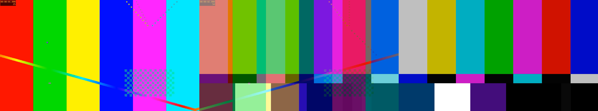

# First cut

Cut two generated clips and a score into a new Premiere Pro project with a 12-frame cross dissolve, and
export a ProRes 422 HQ master. The still frames below were exported by Premiere Pro from that project at
1, 2 and 4 seconds; the middle one is inside the dissolve.



## Reproduce it

You need the server [installed and registered](../../docs/premiere-mcp/source/pages/introduction/installation.md),
the [Bridge relay approved](../../docs/premiere-mcp/source/pages/guides/bridge-setup.md) and FFmpeg. Make the
inputs in a folder `/work`:

```sh
ffmpeg -y -f lavfi -i "testsrc2=size=1280x720:rate=25:duration=3" -c:v libx264 -pix_fmt yuv420p -g 25 /work/pattern.mp4
ffmpeg -y -f lavfi -i "smptebars=size=1280x720:rate=25:duration=3" -c:v libx264 -pix_fmt yuv420p -g 25 /work/bars.mp4
ffmpeg -y -f lavfi -i "sine=frequency=220:duration=5" -c:a pcm_s16le -ar 48000 /work/score.wav
```

Ask your agent to call `premiere_cut` with the arguments in [cut.json](cut.json), then to open the project
with `premiere_project` and export stills with `premiere_frame_export` at 1, 2 and 4 seconds.

## What it returned

[results.json](results.json) holds the measured results: the `premiere_cut` answer, the master as
`ffprobe` reads it (ProRes `apch`, 1280 by 720, 25 fps, 125 frames), the sequence as `premiere_inspect`
reports it, and the still sizes. Paths in the file are shortened to `/work`.

- The master has 125 frames because the 5 second score sets the length; the clips end at 4.52 seconds
  (`cut_frames` 113).
- The second clip's source in point is 0.48 seconds: 0.5 seconds falls between frames at 25 fps and cut
  times snap to the frame grid.
- The dissolve runs from 1.76 to 2.24 seconds, centered on the cut at 2 seconds.

The generated clips, the project and the master are not included; the inputs come from the commands
above.
